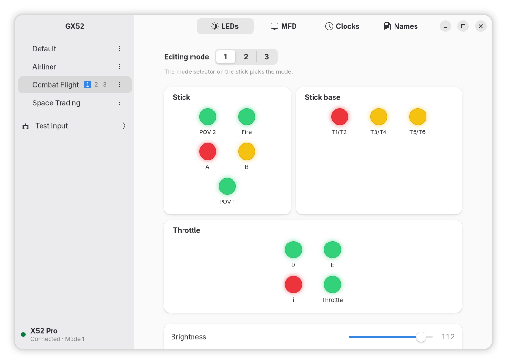

<h1 align="center">
  
  <br>GX52
</h1>

<p align="center"><strong>Configure the LEDs, the display and the profiles of the Logitech (Saitek)
X52 and X52 Pro joysticks on Linux.</strong></p>

<p align="center">
  <a href="https://github.com/leinardi/gx52/actions/workflows/ci.yaml"></a>
  <a href="https://flathub.org/apps/com.leinardi.gx52"></a>
  <a href="COPYING.txt"></a>
</p>

<p align="center">
  <a href="https://leinardi.github.io/gx52/">Documentation</a> ·
  <a href="#-installation">Install</a> ·
  <a href="CONTRIBUTING.md">Contributing</a>
</p>

<p align="center">
  
</p>

GX52 is a GNOME application written in Rust with GTK 4 and libadwaita, distributed through
Flathub. It is developed and tested on the X52 Pro; the plain X52 is supported on a best effort
basis, as [Getting started][start] explains.

## ✨ Features

- **LEDs and display:** LED colours and blinking, the MFD text and three clocks in real time zones.
- **Profiles:** one set of settings or one per mode, with custom control names and TOML files.
- **Input tester and virtual mouse:** every axis and button live, and a ministick pointer.
- **Runs in the background:** a tray icon, starting on login, with guidance for the udev rule.

## 📦 Installation

```bash
flatpak install flathub com.leinardi.gx52
flatpak run com.leinardi.gx52
```

<a href="https://flathub.org/apps/com.leinardi.gx52"></a>

GX52 needs a udev rule before it can set anything; it shows the rule and how to install it the
first time it cannot open the device. The beta channel, the rule, the command line and where the
settings are stored are in [Getting started][start].

## 🛠️ Building from source

Meson and Cargo, with the libraries of the GNOME 51 runtime: see [Building from source][build].
The development build and its Flatpak are in [CONTRIBUTING.md](CONTRIBUTING.md).

## 🤝 Contributing

Bug reports and feature requests go to the [issue tracker](https://github.com/leinardi/gx52/issues).
[CONTRIBUTING.md](CONTRIBUTING.md) covers building, checks, branches, commits and translations;
[SECURITY.md](SECURITY.md) explains how to report a vulnerability privately.

## 📝 License

GX52 is free software under the [GNU General Public License, version 3 or
later](COPYING.txt). Copyright (c) 2019 Roberto Leinardi.

[start]: https://leinardi.github.io/gx52/getting-started/
[build]: https://leinardi.github.io/gx52/building/
