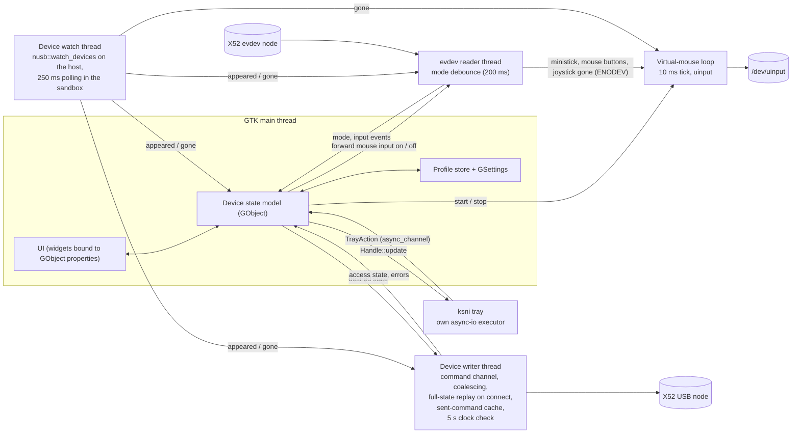

# GX52 architecture

How the Rust rewrite is built: crates, threads and data flow, the state model, persistence, errors,
the sandbox and the test strategy. The decisions behind it are in
[rewrite-analysis.md](rewrite-analysis.md) (sections 1, 5, 10 and 12); what the device does is in
[protocol.md](protocol.md); the profile format is in [profiles.md](profiles.md). Where a value
comes from a spike, the spike is named.

## Skills

The skills rule is in [AGENTS.md, "Project skills"](../AGENTS.md#project-skills) and is not repeated
here. On top of it:

- The Meson + Cargo + Blueprint + Flatpak scaffold of milestone M0 is generated with the
  `gtk-rs-new-app` skill, as spike S6 did (`spikes/s6-hello` on the `spikes` branch).
- Every review uses the project's `adversarial-review` skill, which routes Rust and GTK code to
  `gtk-rs-review` and `rust-review`.
- Each roadmap task that touches code points to the AGENTS.md rule, so the skills are loaded before
  the work starts.

## Workspace

As committed in `a763177`; the crates are still stubs.

| Member | Path | Role |
| --- | --- | --- |
| `gx52` | the repository root (`Cargo.toml`, `src/`), next to `meson.build` | The application: GTK 4 + libadwaita UI, device service, profile store, tray, virtual mouse |
| `x52` | `x52/` | Protocol encoding over a transport trait, device model (X52 Pro / X52 capabilities and LED set), MFD character set, evdev input map. Pure and unit-tested, no GTK dependency |
| `meta` | `meta/` | Repository meta-tests: docs links, license headers, toolchain pins, vacuous flags, workspace lints, one version source. Run by cargo only, on the bare CI runner: they read the git checkout |

- **Lints** live only in `[workspace.lints]` of the root `Cargo.toml`; every member opts in with
  `[lints] workspace = true`. `unsafe_code = "deny"`: nothing in the app needs `unsafe`. USB goes
  through `nusb`, evdev reads and the uinput device through the `evdev` crate's safe API, as in the
  S9 spike (and S1, S3, S4 for `nusb` and evdev reads).
- **Toolchain:** `rust-toolchain.toml` pins `1.98.0`, the same release as the workspace
  `rust-version` and as the Rust of `org.freedesktop.Sdk.Extension.rust-stable//26.08`, which the
  Flatpak builds use. The pin follows that extension: Cargo refuses a `rust-version` newer than its
  `rustc`, so a pin ahead of the extension breaks the Flatpak build.
- **Meson + Cargo:** the layout of the S6 scaffold. Meson drives Cargo for the root package,
  sets the constants of `src/config.rs` (app ID, profile, version, paths) through the environment
  of its cargo invocations (`option_env!`, with Devel defaults so a plain `cargo build` works),
  compiles the Blueprint templates and
  the GResource, installs the desktop file, metainfo, icons and GSettings schema, and runs their
  validation in `meson test`. The Devel profile builds `com.leinardi.gx52.Devel`. S6 built this on
  the host, as a Devel Flatpak and as an offline Flathub-style build. The `x52` and `meta` crates
  are built by Cargo only.
- **Versions:** GNOME 50 required, GNOME 51 runtime (S6 decision): `gtk4` 0.11 with `gnome_50`,
  `libadwaita` 0.9 with `v1_9` + `gtk_v4_22`, Meson `gtk4 >= 4.22`, `libadwaita-1 >= 1.9`. A feature
  is raised only when an API needs it, together with the Meson check.

The `x52` crate holds what can be checked without a device or a display: the typed commands of
[protocol.md, "Commands the app may send"](protocol.md#commands-the-app-may-send) and their
encoding, the LED bits, the character-set conversion, the evdev key and axis names, the mode
debounce and the MFD clock arithmetic. The transport is a trait with one method that sends one
encoded control transfer; the app implements it with `nusb`, the tests with a recording mock.

## Testability

- **Transport trait:** every device test runs the real encoding against a recording transport and
  asserts the exact `(wIndex, wValue)` sequence: full-state replay, LED colour order (green bit,
  then red bit), MFD line clear and padding.
- **Injected clock:** the MFD clock logic (clock 1 time, clock 2/3 offsets from clock 1, the
  normalisation into `−720`–`+720` minutes from [protocol.md](protocol.md#usb-vendor-commands), the
  next instant to re-send) takes the current time and zone as input from a time source the app
  passes in, never from a direct `now()` call. Then `clippy.toml` `disallowed-methods` can ban
  `jiff::Timestamp::now`, `jiff::Zoned::now` and `std::time::SystemTime::now` everywhere except the
  one production time source, whose exception is an `#[expect]` with a reason. This is the
  [tooling-todo.md](tooling-todo.md#needs-the-cargo-workspace) `clippy.toml` item.
- **Event timestamps:** the mode debounce uses the timestamps evdev puts on each event, not the
  wall clock, so it is tested with recorded event sequences (the S3 bounce log is the first
  fixture).

## Untrusted input

Two inputs come from files the app did not write itself: imported profile files (and hand-edited
ones in the profile directory) and the legacy `gx52.db`. Both are parsed as untrusted:

- a size limit before parsing (the limits are set in [profiles.md](profiles.md#files));
- no panics on any content: every read returns a `Result`, no `unwrap` or indexing on file data
  (the workspace lints already deny `unwrap_used` and `expect_used` outside tests);
- validation per field as [profiles.md](profiles.md#validation-and-recovery) defines it, before a
  value reaches the device model; values that cannot be represented never become commands: the typed
  commands in `x52` are built only through constructors that check every range at run time
  (brightness `0`–`128`, offsets `0`–`720`, ...), and the type system guarantees that nothing
  reaches the transport without going through them;
- the legacy database is never opened or modified: a private copy is read (rewrite analysis,
  section 10; [profiles.md](profiles.md#files)).

The boundaries, with the rule each keeps and the tests that hold it, are listed in the
`adversarial-review` skill's untrusted-input pass; M3 decided against a separate `trust-boundary`
skill ([tooling-todo.md](tooling-todo.md#docs-and-project-files)). The check of
[SECURITY.md](../SECURITY.md) against the final import/export path is still open there.

## Threads and data flow

Nothing blocks the GTK main thread (AGENTS.md). Each long-lived loop that blocks gets its own thread
and talks to the main thread through `async_channel` (blocking send on the worker, `recv().await` in
a `glib::spawn_future_local` loop), following the gtk-rs-development "long-lived workers" pattern.
Workers never touch GObjects; only plain `Send` data crosses a channel. The main thread never blocks
on a send either: channels towards workers are unbounded `std::sync::mpsc` channels, whose `send`
never blocks, and the writer's coalescing keeps the queue short.



- **GTK main thread.** Widgets, GObject models, GSettings, the profile store's in-memory state, and
  the decisions: which profile is active, what the device should show. File I/O for the profile
  store and the legacy import runs in `gio::spawn_blocking` or GIO async calls, never inline.
- **Device writer thread.** Owns the opened `nusb::Device` and nothing else touches it
  (`src/device/writer.rs`). Messages in: the desired state, `Selected` and `Gone` from the device
  watch, `Retry` from the user, `Shutdown`. Events out: the access state and errors, each error
  reported once until the device recovers.
  - **Sent-command cache:** the writer keeps, per `x52::command::CommandSlot`, the encoded
    transfers it last sent successfully. On every wake it resolves the desired state at the
    injected clock's current instant (`x52::state::DeviceState::resolve`) and sends exactly the
    commands whose transfers differ from the cache, then updates the cache. There is no
    state-to-state diff: the comparison is with what the device was last told.
  - **Coalescing:** before resolving, it drains every queued message and keeps only the latest
    state, so a dragged brightness slider becomes one transfer per drain, not one per pixel. The
    S7 worker (`spikes/s7-led-editor/src/device.rs` on the `spikes` branch) kept the latest command
    per LED in a map and replayed that map on every connect.
  - **Full-state replay on connect:** a newly opened device starts with an empty cache, so its
    first wake sends the full state, brightness first, then LEDs, MFD lines, clocks, date, shift
    and blink, as [protocol.md, "Power-on state"](protocol.md#power-on-state) requires. Start-up,
    hotplug, a replug into the same port (a new generation of the selection), a resume that
    re-enumerates the device and a granted permission all go through a new open. S7's worker did
    this and the device caught up within about a second after a replug.
  - **Permission:** `EACCES` on `open` gives "found, no permission". While in it the writer retries
    `open` every **1 s** on both backends (host and sandbox), at once on every `Selected` and on
    "Try again" (`Retry`), so an ACL restored with `udevadm trigger` and no hotplug event is
    noticed (S4: the ACL comes back without a replug). A failed transfer drops the handle and the
    cache, and the writer retries `open` every 1 s for as long as the device stays selected, so a
    transient failure or a missed reattachment never leaves it waiting for an event that may not
    come.
  - **Clocks and the wake schedule:** the writer owns the injected time source. The desired state
    carries only clock *sources* (local, UTC, a zone, a fixed offset) and 12/24 h; the writer turns
    them into the clock 1 time and the clock 2/3 offsets it sends, with the `x52` clock logic; the
    device clock does not tick by itself (S2). The writer wakes at the earlier of the next instant
    a clock has to be re-sent (the next minute boundary, or an earlier DST transition from `jiff`)
    and **5 s** of monotonic time. Because every wake compares the resolved clock commands with
    the cache, a minute rollover, a date rollover, a DST transition, a forward jump and a backward
    wall-clock jump are all corrected within 5 s.
  - **Resume (decided in M2):** monotonic time does not advance during suspend, so a pending wait
    ends at most 5 s after the resume and the clocks are re-sent then. The app asks for no logind
    D-Bus permission to hear about suspend; a resume that re-enumerates the USB device is a new
    selection with a reopen and a full replay.
  - **Channels:** messages towards the workers go through `std::sync::mpsc` (unbounded, so the main
    thread never blocks on a send; the writer waits with `recv_timeout`), events towards the main
    thread through `async_channel`, which the main thread awaits in a `glib::spawn_future_local`
    loop. Monotonic time comes from an injected source too, so the tests drive every schedule
    without sleeping.
- **evdev reader thread.** Follows the device watch's selection (`src/device/reader.rs`). USB
  presence and evdev readiness are tracked apart: while a device is selected and its evdev node is
  not found or cannot be opened, the reader looks for it again every 250 ms (the node can appear a
  poll after the USB device, S4). A node belongs to the selected device when its sysfs device
  (`/sys/class/input/eventN/device`, canonicalised) lies under the selected USB device's sysfs
  directory, so USB and evdev always come from the same physical device. It opens the node
  **without grabbing** (games keep every input), reads the initial mode with `EVIOCGKEY`, reads
  events nonblocking with `poll(2)`, applies the mode debounce of
  [protocol.md](protocol.md#mode-selector), and sends mode changes and, when something listens (the
  input tester in 1.x), input events to the main thread. Nothing logs per event (axis noise, S3).
  - The poll timeout is the debounce deadline capped at 250 ms, so a hold is applied without a
    further event and a shutdown or a new selection is noticed within 250 ms. evdev timestamps
    follow the wall clock, so the time since the last key event is measured with monotonic time.
  - On `ENODEV` or a read error it closes the node and looks for it again while the USB device
    stays selected; on `Gone` for its generation it stops reading.
  - Control transfers and evdev reads do not disturb each other (S3), so writer and reader are
    independent.
- **Virtual-mouse loop.** Its own thread, owned by the main thread: started when the GSettings
  switch is on (and a joystick is connected), stopped when it is turned off. It drives the uinput
  device on a 10 ms tick with the S9 values
  ([protocol.md, "Virtual mouse"](protocol.md#virtual-mouse-uinput)).
  - Input: the reader forwards ministick positions and mouse-button events to the loop only while
    the main thread has told it the loop is running, so nothing queues up while it is stopped.
  - "Stop" from the main thread, "joystick gone" from the reader (its read fails with `ENODEV`, as
    in S9) or "gone" from the device watch all lead to the same step: the loop sends `BTN_LEFT` and
    `BTN_RIGHT` up followed by `SYN_REPORT`, then stops (on "stop") or waits for the joystick to
    come back (on "gone"), keeping or destroying the uinput device as M7 decides.
  - A failure to create the uinput device (no permission) is reported to the main thread, which
    shows the guidance page.
- **Device watch.** One component, two sources (S4, `src/device/watch.rs`): `nusb::watch_devices`
  when not sandboxed, re-listing the USB devices at start, after every hotplug event (a
  `Disconnected` carries no vendor or product ID) and every 5 s, because the kernel drops hotplug
  events when the netlink socket overflows (`ENOBUFS`, seen on resume from suspend) and `nusb`
  only logs it; and polling `nusb::list_devices` every 250 ms in
  the sandbox (detected through `/.flatpak-info`), where the hotplug stream never yields. It
  matches by vendor and product ID, never by address, and tells the writer, the reader and the
  main thread when a device is selected or gone. The main thread is told first: the reader's
  first mode for a selection always reaches the main thread after the `Selected` that starts it,
  so the `Selected` never clears that mode.
  - **Selection:** the USB device's sysfs path is the selection key. With nothing selected, the
    first supported device in sysfs-path order is selected; the selection is kept while that path
    stays listed, whatever the enumeration order and whatever else appears (a second X52 does not
    steal it). When the path goes, the watch sends `Gone` for its generation and selects the next
    supported device, if any.
  - **Reattachment:** every selection has a generation. A host `Disconnected` for the selected
    attachment, or a different attachment at the selected path (a replug faster than the re-list,
    or between two polls), sends `Gone` for the old generation and `Selected` with the same path,
    the new attachment and a new generation, so the writer reopens and replays everything. A
    disconnected attachment is left out of the listings until one no longer contains it, since
    its sysfs directory can outlive the event for a moment.
  - **Shutdown:** the hotplug stream is awaited with `futures_lite::future::or` against a shutdown
    signal; the polling loop waits on the same signal with the 250 ms timeout. Dropping the
    trigger signals both.
- **ksni tray.** `ksni` with the `async-io` feature runs its own executor thread and is spawned from
  `glib::spawn_future_local` (desk research, S5). Menu callbacks send a `TrayAction` through an
  `async_channel` to a main-thread loop; the main thread pushes state with `Handle::update`. The
  `Handle` is stored and `shutdown()` is called from the application's `shutdown`. Tray
  availability is a tri-state (unknown, available, not available) where a successful `spawn()` only
  fills "unknown", because the offline report can arrive first (S5). "Close hides to tray" uses it,
  and a watcher that goes away while the window is hidden brings the window back and drops the
  application hold.
- **Background and autostart:** the Background portal through `ashpd` (`request_background` with
  autostart), with `default-features = false` and the `async-io` and `background` features (ashpd
  0.13), awaited on the main context, so the app adds no tokio runtime. While the window is hidden
  the app holds an `ApplicationHoldGuard`; re-activating the app drops it (S5).

## State model

```text
device type ─┐
active mode ─┼─> mapped profile for that type ─┐
             │                                 ├─> desired device state ─> writer
clocks ──────┴─────────────────────────────────┤
overrides ─────────────────────────────────────┘
```

- The **desired device state** is a plain `x52` value: LED states (X52 Pro only), both brightness
  values, three MFD lines, clock 1 source and 12/24 h, clock 2/3 sources and 12/24 h, date format,
  shift, blink. It holds clock sources, not times: the writer resolves them (see the writer above).
  It is computed on the main thread from:
  - the **device type** of the connected device (`x52-pro` or `x52`), which also decides which
    fields exist (no LEDs, shift or blink on the non-Pro, per
    [protocol.md](protocol.md#x52-non-pro));
  - the **active mode** (from the reader) mapped to a profile **for that device type** through the
    per-type mode mapping in GSettings (see [profiles.md](profiles.md#mode-mapping)); a missing or
    wrong-type profile falls back to that type's default profile. Until the reader reports a
    mode, mode 1 is used. The last reported mode is kept while the evdev node is reopened and
    dropped when the device goes. Until the store has loaded, the built-in default is sent. The
    state is pushed again on a new selection, a mode change, a change of either mapping key and
    once the store has loaded (`src/application.rs`, `push_desired_state`);
  - the **clocks**: the clock sources of the profile (clock 1 local or UTC, clocks 2/3 a zone or a
    fixed offset), which the writer turns into wire values;
  - **overrides**: temporary values on top of the profile, such as live edits not yet saved and,
    in 1.x, MFD pages and D-Bus requests.
- It is **pushed to the writer** whenever an input changes. The writer decides what to send (only
  changes, or everything on connect).
- The **UI binds to GObject properties**: a device object (access state, device type, active mode,
  connected), profile objects (one per profile, with properties per field) and the active profile.
  Widgets bind in Blueprint or with `bind_property(...).sync_create()`; behaviour is exposed as
  actions. Models never import widgets.
- **Connecting a different supported model** (an X52 Pro unplugged, an X52 plugged in) switches to
  that type's mapping and that type's profiles; the UI shows only the fields the type has.

## Virtual mouse

From S9; the 1.0.0 scope is an on/off switch with fixed values.

- **Off by default**, enabled by a GSettings switch. The switch exists because the feature needs the
  uinput permission and some games may react to the ministick axes too.
- **Needs the uinput permission** (the second udev rule line in
  [protocol.md](protocol.md#udev-rule)). When it is missing, creating the uinput device fails and
  the guidance page explains the rule, including the security note that uinput write access lets the
  user's programs inject input. The USB access state is unaffected.
- **Releases held buttons:** on joystick disconnect or when the switch is turned off, the loop sends
  `BTN_LEFT` and `BTN_RIGHT` up followed by `SYN_REPORT`, whether or not the uinput device is kept
  alive.
- The joystick is never grabbed, so games still see the ministick and mouse buttons (S9: no side
  effects in X4: Foundations). Hiding them needs a grab plus a virtual joystick and is not planned.

## Persistence

- **GSettings** (schema id and path from the app ID; the Devel build has its own): app settings
  (tray, run in background / autostart, virtual mouse switch, window state, the legacy-import-done
  flag) and the **per-type mode mappings** (profile ids for modes 1/2/3 per device type). One
  `gio::Settings` instance, held by the application.
- **Profile store:** one TOML file per profile in the user config directory, atomic writes; the
  format, defaults, validation and recovery rules are in [profiles.md](profiles.md). The code is
  in `src/profile/`: plain Rust with no GObject, whose file operations block (`files.rs`: the
  size-capped read, `gio::File::replace_contents` for a save, create-new writes for every new file,
  backups that never overwrite a backup). The application loads the store once at start-up in
  `gio::spawn_blocking`, keeps it on the main thread, logs the load report and shows its one toast.
  The GObject wrappers the UI binds to come with the profile editor in M5.
- **One-time legacy import:** at start-up, before the store is loaded, if the import flag is not set
  and `gx52.db` exists; a private copy is read; the flag is set even when the database is
  unreadable, so start-up never fails because of it (rewrite analysis, section 10; S8 for the
  schema).

## Errors and logging

- **`x52`:** `thiserror` enums per area (encoding, transport), `Display` lowercase without trailing
  punctuation, causes kept through `source()`.
- **App:** `anyhow` with `.context(...)` inside the app where callers only log or show the error.
  Errors reach the user once, at the boundary: an `adw::Toast` for transient problems (a failed
  transfer, a profile that could not be read), an `adw::AlertDialog` when the user has to decide
  (replacing an unreadable default profile file). A dismissed dialog is not an error. Device
  access problems are states shown on the guidance page, not errors.
- **Logging:** `tracing` + `tracing-subscriber` with an `EnvFilter`; `--debug` maps to a `debug`
  filter and `RUST_LOG` overrides it. GLib, GTK and libadwaita messages are forwarded into
  `tracing` with a GLib log writer (`glib::log_set_writer_func`), so there is one filter and one
  format (rewrite analysis, section 5.5). Log once, where an error is handled; never per input
  event.

## Sandbox and permissions

The Flatpak `finish-args` beyond the display sockets:

- `--device=all`: the USB node, the evdev node and `/dev/uinput` (S4, S9: without it `/dev/uinput`
  does not exist in the sandbox). Device access itself comes from the host udev rule.
- `--talk-name=org.kde.StatusNotifierWatcher` for the tray (S5; accepted by `flatpak-builder-lint`
  in S6); no well-known name is owned (`disable_dbus_name(true)`).
- **No network**: hotplug works by polling (S4), so `--share=network` is not needed. It is added
  only with the X-Plane adapter in 1.x (risk R12).
- `--filesystem=/run/x52d.cmd:ro`: only so the device watch can see a running libx52 `x52d` by its
  command socket ([protocol.md, "libx52's x52d"](protocol.md#libx52s-x52d); risk R11). Accepted
  by `flatpak-builder-lint`.
- No other filesystem permission: profile import and export go through `gtk::FileDialog` (the
  file chooser portal); the legacy database is in the app's own config directory (rewrite
  analysis, section 10).

## Testing strategy

- **Protocol unit tests** in `x52`: every command's encoding and range, the LED bits, the
  character-set conversion and fallbacks, the clock arithmetic with an injected time source, the
  mode debounce with recorded event sequences.
- **Recording transport mock:** device-service tests assert the exact command sequence for a
  connect (full replay), a profile switch, a burst of slider changes (coalesced) and a disconnect.
- **Profile fixtures and round-trip tests:** valid files, every failure case of
  [profiles.md](profiles.md#validation-and-recovery) (malformed, out of range, unknown value, future
  schema), and legacy row → profile → TOML → profile.
- **Legacy DB fixture:** small databases with both schemas found in S8, created by the test suite
  (the real files are not committed).
- **`meson test`:** validates the desktop file, metainfo and GSettings schema and runs
  `cargo test`; it runs in CI inside the Flatpak build on both architectures (S6).
- **Device check harness** (Devel builds only, `src/device/check.rs`): `gx52 --device-check
  <scenario>` runs the device service without a window, before GTK starts, and prints
  timestamped lines: `STEP` (something the user must do), `CHECK` (something to confirm by
  looking), `PASS` and `FAIL` (what it verified itself), `INFO`, `SEND` for every command the
  writer sends, and a `DONE` summary. The scenarios are `smoke` (no user action), `replug`, `mode`,
  `permission`, `resume`, `midnight`, `x52d` and `uinput`. The exit code is 0 when everything
  passed, 1 on a failure, 2 for a command-line error and 3 when a precondition was not met (the
  permission check with a node that stays writable). A release build refuses the option. The
  service runs over a `Backend` (the real system, or fakes), so the tests run every scenario's
  automatic verifications against the real threads over a scripted watch, opener and evdev
  source.
- Repository checks: `make verify` and `make check` (AGENTS.md), and the `meta` crate once it
  exists.

## Extension points for 1.x

Designed in from the start so the 1.x features need no rework (rewrite analysis, section 12):

- **D-Bus API:** GApplication actions plus a D-Bus interface on the app's own bus name (apply a
  profile, set MFD lines or pages, set LEDs). It feeds the overrides of the state model; owning the
  app-ID name needs no Flatpak permission.
- **MFD pages engine:** pages of three 16-character lines built from static text and named values,
  switched with the MFD buttons (which arrive through evdev, S3). It writes into the MFD lines of
  the overrides.
- **Several devices:** device watch, writer and reader are per device, keyed by vendor/product ID
  plus serial or port path (never the USB address, S4); 1.0.0 drives the first device found.
- **Game adapters:** data sources for the MFD pages engine; the first is X-Plane over UDP, which
  needs `--share=network` (R12).
