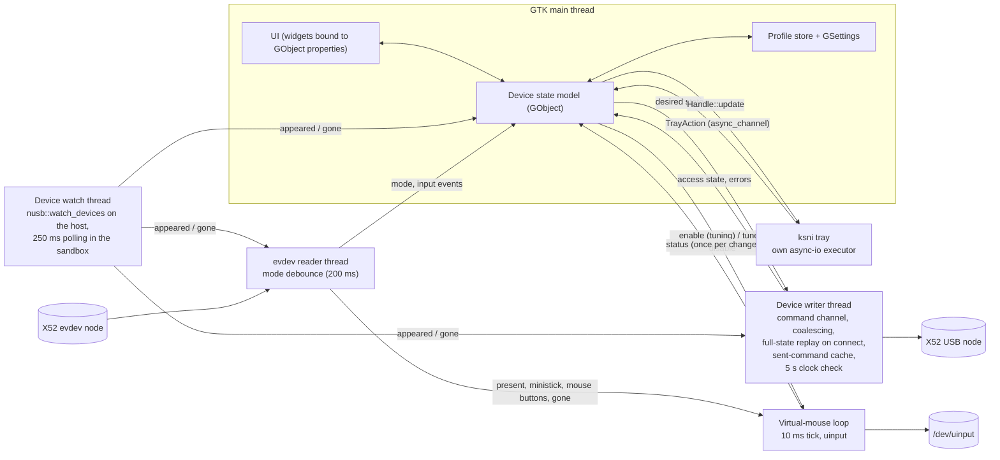

# GX52 architecture

How the Rust rewrite is built: crates, threads and data flow, the state model, persistence, errors,
the sandbox and the test strategy. The decisions behind it are in
[rewrite-analysis.md](https://github.com/leinardi/gx52/blob/main/docs/internal/history/rewrite-analysis.md)
(sections 1, 5, 10 and 12); what the device does is in [protocol.md](protocol.md); the profile
format is in [profiles.md](profiles.md). Where a value comes from a spike, the spike is named.

## Skills

The skills rule is in [AGENTS.md, "Project
skills"](https://github.com/leinardi/gx52/blob/main/AGENTS.md#project-skills) and is not repeated
here. On top of it:

- The Meson + Cargo + Blueprint + Flatpak scaffold of milestone M0 is generated with the
  `gtk-rs-new-app` skill, as spike S6 did (`spikes/s6-hello` on the `spikes` branch).
- Every review uses the project's `adversarial-review` skill, which routes Rust and GTK code to
  `gtk-rs-review` and `rust-review`.
- Each roadmap task that touches code points to the AGENTS.md rule, so the skills are loaded before
  the work starts.

## Workspace

As committed in `a763177`; the crates are still stubs.

| Member | Path | Role |
| --- | --- | --- |
| `gx52` | the repository root (`Cargo.toml`, `src/`), next to `meson.build` | The application: GTK 4 + libadwaita UI, device service, profile store, tray, virtual mouse |
| `x52` | `x52/` | Protocol encoding over a transport trait, device model (X52 Pro / X52 capabilities and LED set), MFD character set, evdev input map. Pure and unit-tested, no GTK dependency |
| `meta` | `meta/` | Repository meta-tests: docs links, license headers, toolchain pins, vacuous flags, workspace lints, one version source. Run by cargo only, on the bare CI runner: they read the git checkout |

- **Lints** live only in `[workspace.lints]` of the root `Cargo.toml`; every member opts in with
  `[lints] workspace = true`. `unsafe_code = "deny"`: nothing in the app needs `unsafe`. USB goes
  through `nusb`, evdev reads and the uinput device through the `evdev` crate's safe API, as in the
  S9 spike (and S1, S3, S4 for `nusb` and evdev reads).
- **Toolchain:** `rust-toolchain.toml` pins `1.98.0`, the same release as the workspace
  `rust-version` and as the Rust of `org.freedesktop.Sdk.Extension.rust-stable//26.08`, which the
  Flatpak builds use. The pin follows that extension: Cargo refuses a `rust-version` newer than its
  `rustc`, so a pin ahead of the extension breaks the Flatpak build.
- **Meson + Cargo:** the layout of the S6 scaffold. Meson drives Cargo for the root package,
  sets the constants of `src/config.rs` (app ID, profile, version, paths) through the environment
  of its cargo invocations (`option_env!`, with Devel defaults so a plain `cargo build` works),
  compiles the Blueprint templates and
  the GResource, installs the desktop file, metainfo, icons and GSettings schema, and runs their
  validation in `meson test`. The Devel profile builds `com.leinardi.gx52.Devel`. S6 built this on
  the host, as a Devel Flatpak and as an offline Flathub-style build. The `x52` and `meta` crates
  are built by Cargo only.
- **Versions:** GNOME 50 required, GNOME 51 runtime (S6 decision): `gtk4` 0.11 with `gnome_50`,
  `libadwaita` 0.9 with `v1_9` + `gtk_v4_22`, Meson `gtk4 >= 4.22`, `libadwaita-1 >= 1.9`. A feature
  is raised only when an API needs it, together with the Meson check.

The `x52` crate holds what can be checked without a device or a display: the typed commands of
[protocol.md, "Commands the app may send"](protocol.md#commands-the-app-may-send) and their
encoding, the LED bits, the character-set conversion, the evdev key and axis names, the mode
debounce and the MFD clock arithmetic. The transport is a trait with one method that sends one
encoded control transfer; the app implements it with `nusb`, the tests with a recording mock.

## Testability

- **Transport trait:** every device test runs the real encoding against a recording transport and
  asserts the exact `(wIndex, wValue)` sequence: full-state replay, LED colour order (green bit,
  then red bit), MFD line clear and padding.
- **Injected clock:** the MFD clock logic (clock 1 time, clock 2/3 offsets from clock 1, the
  normalisation into `−720`–`+720` minutes from [protocol.md](protocol.md#usb-vendor-commands), the
  next instant to re-send) takes the current time and zone as input from a time source the app
  passes in, never from a direct `now()` call. Then `clippy.toml` `disallowed-methods` can ban
  `jiff::Timestamp::now`, `jiff::ZonedDateTime::now` and `std::time::SystemTime::now` everywhere except the
  one production time source, whose exception is an `#[expect]` with a reason. This is the
  [tooling-todo.md](https://github.com/leinardi/gx52/blob/main/docs/internal/tooling-todo.md#needs-the-cargo-workspace)
  `clippy.toml` item.
- **Event timestamps:** the mode debounce uses the timestamps evdev puts on each event, not the
  wall clock, so it is tested with recorded event sequences (the S3 bounce log is the first
  fixture).

## Untrusted input

Two inputs come from files the app did not write itself: imported profile files (and hand-edited
ones in the profile directory) and the legacy `gx52.db`. Both are parsed as untrusted:

- a size limit before parsing (the limits are set in [profiles.md](profiles.md#files));
- no panics on any content: every read returns a `Result`, no `unwrap` or indexing on file data
  (the workspace lints already deny `unwrap_used` and `expect_used` outside tests);
- validation per field as [profiles.md](profiles.md#validation-and-recovery) defines it, before a
  value reaches the device model; values that cannot be represented never become commands: the typed
  commands in `x52` are built only through constructors that check every range at run time
  (brightness `0`–`128`, offsets `0`–`720`, ...), and the type system guarantees that nothing
  reaches the transport without going through them;
- the legacy database is never opened or modified: a private copy of a consistent snapshot is
  read, and an import whose files keep changing is deferred (rewrite analysis, section 10;
  [profiles.md](profiles.md#files)).

The boundaries, with the rule each keeps and the tests that hold it, are listed in the
`adversarial-review` skill's untrusted-input pass; M3 decided against a separate `trust-boundary`
skill
([tooling-todo.md](https://github.com/leinardi/gx52/blob/main/docs/internal/tooling-todo.md#docs-and-project-files)).
The check of [SECURITY.md](https://github.com/leinardi/gx52/blob/main/SECURITY.md) against the final
import/export path is still open there.

## Threads and data flow

Nothing blocks the GTK main thread (AGENTS.md). Each long-lived loop that blocks gets its own thread
and talks to the main thread through `async_channel` (blocking send on the worker, `recv().await` in
a `glib::spawn_future_local` loop), following the gtk-rs-development "long-lived workers" pattern.
Workers never touch GObjects; only plain `Send` data crosses a channel. The main thread never blocks
on a send either: channels towards workers are unbounded `std::sync::mpsc` channels, whose `send`
never blocks, and the writer's coalescing keeps the queue short.



- **GTK main thread.** Widgets, GObject models, GSettings, the profile store's in-memory state, and
  the decisions: which profile is active, what the device should show. File I/O for the profile
  store and the legacy import runs in `gio::spawn_blocking` or GIO async calls, never inline.
- **Device writer thread.** Owns the opened `nusb::Device` and nothing else touches it
  (`src/device/writer.rs`). Messages in: the desired state, `Selected` and `Gone` from the device
  watch, `Retry` from the user, `Shutdown`. Events out: the access state and errors, each error
  reported once until the device recovers.
  - **Sent-command cache:** the writer keeps, per `x52::command::CommandSlot`, the encoded
    transfers it last sent successfully. On every wake it resolves the desired state at the
    injected clock's current instant (`x52::state::DeviceState::resolve`) and sends exactly the
    commands whose transfers differ from the cache, then updates the cache. There is no
    state-to-state diff: the comparison is with what the device was last told.
  - **Coalescing:** before resolving, it drains every queued message and keeps only the latest
    state, so a dragged brightness slider becomes one transfer per drain, not one per pixel. The
    S7 worker (`spikes/s7-led-editor/src/device.rs` on the `spikes` branch) kept the latest command
    per LED in a map and replayed that map on every connect.
  - **Full-state replay on connect:** a newly opened device starts with an empty cache, so its
    first wake sends the full state, brightness first, then LEDs, MFD lines, clocks, date, shift
    and blink, as [protocol.md, "Power-on state"](protocol.md#power-on-state) requires. Start-up,
    hotplug, a replug into the same port (a new generation of the selection), a resume that
    re-enumerates the device and a granted permission all go through a new open. S7's worker did
    this and the device caught up within about a second after a replug.
  - **Permission:** `EACCES` on `open` gives "found, no permission". While in it the writer retries
    `open` every **1 s** on both backends (host and sandbox), at once on every `Selected` and on
    "Try again" (`Retry`), so an ACL restored with `udevadm trigger` and no hotplug event is
    noticed (S4: the ACL comes back without a replug). A failed transfer drops the handle and the
    cache, and the writer retries `open` every 1 s for as long as the device stays selected, so a
    transient failure or a missed reattachment never leaves it waiting for an event that may not
    come.
  - **Clocks and the wake schedule:** the writer owns the injected time source. The desired state
    carries only clock *sources* (local, UTC, a zone, a fixed offset) and 12/24 h; the writer turns
    them into the clock 1 time and the clock 2/3 offsets it sends, with the `x52` clock logic; the
    device clock does not tick by itself (S2). The writer wakes at the earlier of the next instant
    a clock has to be re-sent (the next minute boundary, or an earlier DST transition from `jiff`)
    and **5 s** of monotonic time. Because every wake compares the resolved clock commands with
    the cache, a minute rollover, a date rollover, a DST transition, a forward jump and a backward
    wall-clock jump are all corrected within 5 s.
  - **Resume (decided in M2):** monotonic time does not advance during suspend, so a pending wait
    ends at most 5 s after the resume and the clocks are re-sent then. The app asks for no logind
    D-Bus permission to hear about suspend; a resume that re-enumerates the USB device is a new
    selection with a reopen and a full replay.
  - **Channels:** messages towards the workers go through `std::sync::mpsc` (unbounded, so the main
    thread never blocks on a send; the writer waits with `recv_timeout`), events towards the main
    thread through `async_channel`, which the main thread awaits in a `glib::spawn_future_local`
    loop. Monotonic time comes from an injected source too, so the tests drive every schedule
    without sleeping.
- **evdev reader thread.** Follows the device watch's selection (`src/device/reader.rs`). USB
  presence and evdev readiness are tracked apart: while a device is selected and its evdev node is
  not found or cannot be opened, the reader looks for it again every 250 ms (the node can appear a
  poll after the USB device, S4). A node belongs to the selected device when its sysfs device
  (`/sys/class/input/eventN/device`, canonicalised) lies under the selected USB device's sysfs
  directory, so USB and evdev always come from the same physical device. It opens the node
  **without grabbing** (games keep every input), reads the initial mode with `EVIOCGKEY`, reads
  events nonblocking with `poll(2)`, applies the mode debounce of
  [protocol.md](protocol.md#mode-selector), and sends to the main thread mode changes, **every key
  event** (buttons, toggles, the hats that are keys) and **the POV 1 hat axes** (`ABS_HAT0X` /
  `ABS_HAT0Y`), a few events per second at most, and the other **axis events** only while the
  input tester listens. Nothing logs per event (axis noise, S3).
  - Key and hat events always flow because the MFD "Last button" source needs them while the
    window is hidden. The reader's events (`ReaderEvent`) are `NodeOpened`, `NodeClosed`, `Mode`,
    `Held` and `Axes`. A `Held` change is a `Snapshot`, a `Key` (a button other than the mode
    selector, pressed or released; repeats are dropped) or a `Pov1` position (sent only when it
    changes).
    The main thread keeps the set of held buttons and hat directions from them, an
    `x52::input::HeldInputs` in press order, whose newest entry is the "last button". On every
    open of the node the reader sends the current key and hat state (`EVIOCGKEY`, `EVIOCGABS`)
    before any event, so the set is rebuilt; on `ENODEV`, a read error, `Gone` or a reader
    shutdown the main thread clears the set, so no button stays "held" on the MFD after a
    disconnect. A snapshot says what is held but not since when, so its order is fixed: the held
    keys in ascending evdev code order, then the POV 1 directions (up, right, down, left). The
    "last button" after an open is the POV 1 direction if one is held, else the highest key code.
    The main thread also keeps the notch hold (`device::notch::NotchHold`,
    [profiles.md](profiles.md#control-names)): a wheel notch pressed is shown in place of the
    newest held entry until a 0.7 s `glib` timeout fires, another control is pressed (a key, or a
    POV 1 direction not held before), a snapshot arrives or the set is cleared. The hold follows
    the kind of change, never a comparison of sets, since a snapshot is not a press. A change
    pushes the state only when the input shown changed and the set on the device shows a "last
    button" line, and never logs. The line shows that input's custom name in the mode shown, else
    its built-in name.
  - The other axes flow only while an input tester is shown. The main thread counts the testers
    that are mapped (`Application::listen_to_axes` and `ignore_axes`) and sends the reader
    `ListenToAxes` on the first and `IgnoreAxes` after the last, so nothing streams while the
    window is hidden or another page is shown. The flag is kept across node reopens and new
    selections. While it is on, the reader sends an `Axes` `Snapshot` (every axis but POV 1's,
    with the range and value `EVIOCGABS` reports) for every `ListenToAxes` while a node is open
    (also one right after an `IgnoreAxes`, since the main thread has forgotten the axes by then)
    and on every open while listening, after the held snapshot. Then it sends one `Values` event
    per read with the last value of each axis that moved, so the throttle's noise is coalesced
    to one message per wake-up. The main thread keeps them in an `x52::input::AxisValues`,
    cleared with the held set and when the last tester goes; an `Axes` event that arrives with
    no tester left is dropped. Whether the node is open is part of `DeviceStatus`
    (`input_open`), cleared on `Selected` and `Gone` as well, because the earlier selection's
    `NodeClosed` can be dropped as stale.
  - The poll timeout is the debounce deadline capped at 250 ms, so a hold is applied without a
    further event and a shutdown or a new selection is noticed within 250 ms. evdev timestamps
    follow the wall clock, so the time since the last key event is measured with monotonic time.
  - On `ENODEV` or a read error it closes the node and looks for it again while the USB device
    stays selected; on `Gone` for its generation it stops reading.
  - Control transfers and evdev reads do not disturb each other (S3), so writer and reader are
    independent.
- **Virtual-mouse loop.** Its own thread, "virtual-mouse", part of the device service
  (`src/device/mouse_loop.rs`, the pure mapping in `src/device/mouse.rs`). It drives the uinput
  pointer "GX52 virtual mouse" with the S9 mapping and the tuning of the five GSettings keys
  ([protocol.md, "Virtual mouse"](protocol.md#virtual-mouse-uinput)).
  - One FIFO channel: `Enable(tuning)`, `Tune(tuning)` and `Disable` from the main thread, which
    follows the keys (a tuning change applies to the running pointer, without creating it again),
    and `Shutdown`, which releases both buttons and removes the device before the thread exits;
    `Present`, the ministick values, the four mouse buttons and `Gone` from the reader. The reader
    always forwards them while its node is open, whether or not the switch is on (the kernel queue
    never fills while the mouse is off), and sends `Present` with the ministick's position on
    every open and `Gone` on every close. The loop alone decides what to do with them.
  - Contract: the loop acts on what *arrives* after `Enable`. A click made just before the switch
    turned on, still queued while the reader was not scheduled, can arrive after `Enable` and is
    then injected; this window is accepted. Nothing that arrived before `Enable`, or after
    `Disable`, is emitted, and a button is released only when the loop emitted its press, so no
    button stays held. Buttons held when the node opens are not pressed for the loop.
  - The uinput device exists only while the switch is on and a joystick is present: on `Gone` or
    `Disable` the loop sends `BTN_LEFT` and `BTN_RIGHT` up followed by `SYN_REPORT`, then drops
    the device, which removes it; a replug creates a new one. A leftover pointer could make GNOME's
    "disable touchpad while a mouse is connected" turn a laptop's touchpad off.
  - Failures: a failed creation, or a failed write (motion, a click, a release), releases both
    buttons as far as it can, drops the device, reports the failure to the main thread once
    (`DeviceEvent::VirtualMouse`, sent on every status change and logged there) and, while the
    switch is on and a joystick present, creates the device again every second, so a fixed
    `/dev/uinput` brings the pointer back without a replug or a toggle. A failed release during
    `Gone` or `Disable` still drops the device, with nothing to retry. The Preferences warning
    runs its own access check.
  - Timing: while the pointer exists and a ministick axis is outside the deadzone, ticks fall
    every 10 ms on a monotonic deadline that incoming messages do not move, so frequent reports
    cannot starve motion; missed ticks are skipped, not caught up, so motion never comes in bursts.
    Centred, without a pointer or failed, the loop blocks on its channel or waits only for the
    next retry: no 100 Hz wake-ups while idle.
- **Device watch.** One component, two sources (S4, `src/device/watch.rs`): `nusb::watch_devices`
  when not sandboxed, re-listing the USB devices at start, after every hotplug event (a
  `Disconnected` carries no vendor or product ID) and every 5 s, because the kernel drops hotplug
  events when the netlink socket overflows (`ENOBUFS`, seen on resume from suspend) and `nusb`
  only logs it; and polling `nusb::list_devices` every 250 ms in
  the sandbox (detected through `/.flatpak-info`), where the hotplug stream never yields. It
  matches by vendor and product ID, never by address, and tells the writer, the reader and the
  main thread when a device is selected or gone. The main thread is told first: the reader's
  first mode for a selection always reaches the main thread after the `Selected` that starts it,
  so the `Selected` never clears that mode. The reader's node and mode events carry the
  generation of their selection, and the main thread drops those of any selection but the current
  one, so a mode change of the previous device still in flight never applies to the next.
  - **Selection:** the USB device's sysfs path is the selection key. With nothing selected, the
    first supported device in sysfs-path order is selected; the selection is kept while that path
    stays listed, whatever the enumeration order and whatever else appears (a second X52 does not
    steal it). When the path goes, the watch sends `Gone` for its generation and selects the next
    supported device, if any.
  - **Reattachment:** every selection has a generation. A host `Disconnected` for the selected
    attachment, or a different attachment at the selected path (a replug faster than the re-list,
    or between two polls), sends `Gone` for the old generation and `Selected` with the same path,
    the new attachment and a new generation, so the writer reopens and replays everything. A
    disconnected attachment is left out of the listings until one no longer contains it, since
    its sysfs directory can outlive the event for a moment.
  - **Shutdown:** the hotplug stream is awaited with `futures_lite::future::or` against a shutdown
    signal; the polling loop waits on the same signal with the 250 ms timeout. Dropping the
    trigger signals both.
- **ksni tray** (`src/tray.rs`, `src/application/background.rs`). `ksni` with the `async-io`
  feature runs its own executor thread and is spawned from `glib::spawn_future_local` (desk
  research, S5). The tray item holds only plain data: a `TrayModel` slot (status line, whether a
  window is shown, the connected type's usable profiles) that the main thread publishes and the
  tray reads when the host asks for the menu, so updates in flight never apply out of order; the
  main thread then calls `Handle::update` only to make the host read it again, and only when the
  model changed. Menu callbacks send a `TrayMessage` (the action and the tray's generation)
  through an unbounded `async_channel` to a main-thread loop.
  - **Lifecycle:** the tray shows only while "Run in background" is on and GX52 is not quitting.
    `spawn()` is asynchronous, so every start gets a generation (`TrayLifecycle`): a start that
    completes after the tray was turned off, or after a newer start, has its handle shut down at
    once, and the messages of any generation but the current one are dropped. The handle of the
    running tray is shut down when the setting goes off, on Quit and in the application's
    `shutdown`. Availability is a tri-state (unknown, available, not available) reset by each
    start. `ksni` reports a missing watcher during `spawn()` and never reports a present one for
    the first registration (S5), so a successful start sends `Registered` through the same channel
    as the tray's own reports, after that report; it only fills "unknown". The start's handle
    comes back by another path and sets no availability.
  - **Closing the window** with "Run in background" on destroys it, whether or not a tray is
    available, also after a tray host went away while the window was open (GNOME lists the app under
    Background Apps, and launching it again shows the window;
    [ui.md](https://github.com/leinardi/gx52/blob/main/docs/internal/ui.md#preferences)), and a
    background hold keeps the application, the device service and the tray running; with it off,
    closing quits. Showing the window again builds a new one, so a hidden start (M6 task 2) and a
    closed window are the same state. The hold is separate from the write queue's (see Persistence).
  - **Quit** (the menu, Ctrl+Q, the tray) sets `quitting`: the tray goes, the window closes
    without the background hold and the process ends once the profiles are written. While
    quitting, tray messages are dropped; launching GX52 again calls the quit off.
  - **Activation tokens:** GNOME's AppIndicator extension starts a launch (the busy cursor) for
    every click on the icon or the menu and hands its XDG activation token to the item first
    (`ProvideXdgActivationToken`); the launch lasts until the token is used. Each `TrayMessage`
    carries the token of its click (`ksni::current_xdg_activation_token`, only valid inside the
    callback). A click that shows the window (Show, Preferences, About) presents it with the
    token (`set_startup_id`), which also gives it the focus. Every other click, a dropped one
    included, ends the launch with `gtk_shell1.set_startup_id`, which mutter takes without a
    window: GTK sends it only on a compositor without xdg-activation, so
    `notify_startup_complete` does nothing on GNOME. `src/tray/launch.rs` sends it on a short
    Wayland connection of its own (`wayland-client`, pure-Rust backend, `gtk-shell.xml`
    vendored from GTK 4.22) to the socket GDK uses, on a blocking-pool thread; an X11 display
    still gets `notify_startup_complete`. A Quit that exits at once may end before it is sent;
    the launch then ends with the process.
  - **Closing a window with dialogs** (Hide, Quit) force-closes its dialogs first: with a dialog
    open, closing the window closes only that dialog.
  - A watcher that goes away while no window is there brings the window back (only a host that
    showed the icon: one that never appeared, as on plain GNOME, is not a loss), never while
    quitting. "Run in background" turned off while no window is there shows the window too, since
    the tray goes with it.
- **Background and autostart:** the Background portal through `ashpd` (`request_background` with
  autostart), with `default-features = false` and the `async-io` and `background` features (ashpd
  0.13, which shares ksni's zbus 5; 0.14 moves to zbus 6), awaited on the main context, so the app
  adds no tokio runtime. While no window is there the app holds an `ApplicationHoldGuard`;
  re-activating the app drops it (S5). `src/application/autostart.rs`:
  - **Hidden start:** `gx52 --hidden`, the command of the autostart entry. The application handles
    its command line (`HANDLES_COMMAND_LINE`), in the primary instance: without `--hidden` it shows
    the window, as `activate` does; with it, the primary runs in the background with no window
    while "Run in Background" is on, and shows the window otherwise, since no tray would lead back
    to it. A hidden launch forwarded to a running instance changes nothing. A hidden start while
    "Start on Login" is off comes from a stale entry, which is removed.
  - **Requests:** the `autostart` key asks for the entry on or off whenever it changes (any
    writer, "Run in Background" turned off included, also by the startup normalization, so its
    handler is connected before it), and on at every start while it is on, so the entry follows
    an updated GX52. A request has a side effect, so a stale reply cannot be dropped: requests go
    one at a time, and the one that finishes sends the latest wish if it differs, so the last
    request to finish is always the latest wish. An enable the portal refuses turns the key back
    off and records why (not allowed, or no portal) until the key turns on and the portal agrees,
    the user turns it off, or "Run in Background" goes off; nothing more is asked then. A refusal
    shows as a warning in Preferences, or, with no Preferences dialog showing (a start at login
    has no window), as a banner the next window shows until Preferences opens
    ([ui.md](https://github.com/leinardi/gx52/blob/main/docs/internal/ui.md#preferences)). A permission
    turned off answers Cancelled, like a dismissed dialog, so Cancelled is a refusal also for the
    start's own request; that request only logs a failure: at login the portal may not be ready,
    and turning the key off would remove the entry at the next hidden start. A request holds the
    application, so one sent just before Quit still arrives; Quit waits 5 s for it at most, and a
    follow-up sent while quitting holds nothing. A request the portal leaves unanswered for 2
    minutes counts as failed, so a hung portal does not leave the switch waiting.
  - **Background permission:** GX52 cannot read it, only learn it from a request's answer. With
    it off, xdg-desktop-portal ends any instance of the app id with no window a few seconds after
    the last one closes, "Run in Background" or not, and the same for a `flatpak-builder` test
    run of the Devel id. On Ubuntu 26.04 (xdg-desktop-portal 1.21, GNOME 50) no dialog asks: an
    unset permission is granted and stored as allowed.
  - **Host build:** the app registers its id with `org.freedesktop.host.portal.Registry` before
    the first request (xdg-desktop-portal 1.19 and later; a no-op in the sandbox). On the host the
    entry's `Exec` is `gx52 --hidden`, so `gx52` must be on `PATH`; in the Flatpak the portal
    writes a `flatpak run` line.
  - **Logging:** zbus's proxies warn on every request (ashpd's request object is gone once it
    answered), so the default filter keeps `zbus::proxy` at errors.

## State model

```text
device type ──> active profile for that type ─┐
active mode ──> its mode settings (per-mode) ─┼─> desired device state ─> writer
clocks, MFD line sources ─────────────────────┤
overrides ────────────────────────────────────┘
```

- The **desired device state** is a plain `x52` value: LED states (X52 Pro only), both brightness
  values, three MFD lines, clock 1 source and 12/24 h, clock 2/3 sources and 12/24 h, date format,
  shift, blink. It holds clock sources, not times: the writer resolves them (see the writer above).
  It is computed on the main thread from:
  - the **device type** of the connected device (`x52-pro` or `x52`), which also decides which
    fields exist (no LEDs, shift or blink on the non-Pro, per
    [protocol.md](protocol.md#x52-non-pro));
  - the **active profile for that device type** (GSettings, see
    [profiles.md](profiles.md#active-profile)); a missing or wrong-type profile falls back to that
    type's default profile. Until the store has loaded, the built-in default is sent;
  - the **active mode** (from the reader), which picks the mode settings of a per-mode profile; a
    single profile has one set and ignores it. Until the reader reports a mode, mode 1 is used. The
    last reported mode is kept while the evdev node is reopened and dropped when the device goes.
    The state is pushed again on a new selection, a mode change, a change of the active profile
    and once the store has loaded or a profile was imported (`src/application.rs`,
    `push_desired_state`; the active id is resolved in `src/profile/active.rs`, the list order in
    `src/profile/order.rs`). It is logged only when the applied profile or mode changes;
  - the **MFD line sources**, resolved into three lines of text: custom text, the active profile's
    name, the name of the most recently pressed button that is still held (from the set of held
    buttons and POV 1 directions above, the mode selector keys excluded), or empty. Every dynamic
    value is converted and cut to 16 bytes as [profiles.md](profiles.md#mfd-lines) says;
  - the **clocks**: the clock sources of the profile (clock 1 local or UTC, clocks 2/3 a zone or a
    fixed offset), which the writer turns into wire values;
  - **overrides**: temporary values on top of the profile: the mode picked in the editor's mode bar
    ([ui.md](https://github.com/leinardi/gx52/blob/main/docs/internal/ui.md#mode-bar)), live edits
    not yet saved and, in 1.x, MFD pages and D-Bus requests. The **mode shown** is the picked mode,
    else the active mode, else mode 1 (`src/profile/editing.rs`); the pick is dropped when the
    selector moves, the active profile changes or becomes single, or the device goes or is selected
    again. The device, the editor and the profile list's badges all show the mode shown; the sidebar
    footer keeps the selector's mode. The editor's edits change the active profile's settings of the
    mode shown, go to the device at once and are saved after the debounce
    (`src/application/editing.rs`).
- The **MFD editor's simulated display** is built from the same desired state
  (`src/profile/active.rs`, `state_for`, then `src/profile/mfd.rs`, `preview`), so it shows exactly
  what is sent: the converted lines, the time of the clock shown as clock 1's plus the offset sent,
  the date with dots. The device gets the connected type's state; the display resolves the shown
  type, so it is there and follows edits with no device connected. Both take the dynamic MFD values
  from one place, so online the display never disagrees with the device; a change of the held
  button updates only the display, never the whole window. The display ticks at each minute
  boundary while it is mapped, reading the system time zone with `gio::spawn_blocking`.
- It is **pushed to the writer** whenever an input changes. The writer decides what to send (only
  changes, or everything on connect).
- The **UI binds to GObject properties**: a device object (access state, device type, active mode,
  connected), profile objects (one per profile, with properties per field) and the active profile.
  Widgets bind in Blueprint or with `bind_property(...).sync_create()`; behaviour is exposed as
  actions. Models never import widgets.
- **Connecting a different supported model** (an X52 Pro unplugged, an X52 plugged in) switches to
  that type's active profile and that type's profiles; the UI shows only the fields the type has.

## Virtual mouse

From S9; the 1.0.0 scope is an on/off switch plus speed, curve, deadzone and wheel direction
settings, defaulting to the S9 values.

- **Off by default**, enabled by a GSettings switch. The switch exists because the feature needs the
  uinput permission and some games may react to the ministick axes too.
- **Needs the uinput permission** (the second udev rule line in
  [protocol.md](protocol.md#udev-rule)). When it is missing, creating the uinput device fails and
  the guidance page explains the rule, including the security note that uinput write access lets the
  user's programs inject input. The USB access state is unaffected.
- **Releases held buttons:** on joystick disconnect or when the switch is turned off, the loop sends
  `BTN_LEFT` and `BTN_RIGHT` up followed by `SYN_REPORT`, then removes the uinput device: it exists
  only while the switch is on and a joystick is connected (M7 decision, "Virtual-mouse loop"
  above).
- The joystick is never grabbed, so games still see the ministick and mouse buttons (S9: no side
  effects in X4: Foundations). Hiding them needs a grab plus a virtual joystick and is not planned.

## Persistence

- **GSettings** (schema id and path from the app ID; the Devel build has its own): app settings
  (run in background, autostart, the virtual mouse switch and settings, window state and the
  last editor view, the legacy-import-done flag, the last device type) and, per device type, the
  **active profile** and the **profile order** ([profiles.md](profiles.md#active-profile)). One
  `gio::Settings` instance, held by the application.
- **Profile store:** one TOML file per profile in the user config directory, atomic writes; the
  format, defaults, validation and recovery rules are in [profiles.md](profiles.md). The code is
  in `src/profile/`: plain Rust with no GObject, whose file operations block (`files.rs`: the
  size-capped read, `gio::File::replace_contents` for a save, create-new writes for every new file,
  backups that never overwrite a backup). The application loads the store once at start-up in
  `gio::spawn_blocking`, keeps it on the main thread, logs the load report and shows its one toast.
  The UI binds to `ProfileObject`s (`src/model/`), one per row of the profile list, which the
  application keeps in one `gio::ListStore` for the shown device type and rebuilds from the
  store, the order and the active profile (`src/profile/list.rs`), keeping the objects of the
  profiles that stay. The shown type is the connected one, or the last one seen (GSettings
  `last-device-type`) while no device is connected.
  - **Edits change the store in memory; file work is a job.** `store.rs` hands out `SaveJob`,
    `AddJob` and `DeleteJob` values (the path, the contents and how to write them) that run in
    `gio::spawn_blocking`; the main thread then commits the result (`saved`, `added`). A removal
    takes the entry out of the store at once (`take`) and deletes its file later; an undo or a
    failed delete puts it back (`restore`). A file that is not a profile is a `Damaged` entry,
    listed under the device type its TOML names (read leniently) or under every type, never
    written, and deleted only by an explicit removal.
  - **One write at a time per profile** (`writes.rs`). The write queue debounces saves (500 ms
    after the last edit) and keeps one lane per profile, so a save and a delete of the same
    profile never overlap and a save never lands after the delete. It also counts the creates (new,
    duplicated, imported profiles) until their profile is in the store. It only decides: it returns
    commands (arm or cancel a timer, start a job) that the application carries out, so every order
    of events is unit-tested.
  - **Names claimed before the store has them** (`reservations.rs`): the name of a create or an
    import while its file is written, and the name of a removed profile until its file is deleted
    or it is restored. Every name check (new, duplicate, rename, import) looks at the store and the
    reservations together, so two profiles of a type never share a name.
  - **Removals until the file is gone** (`removals.rs`): a removed entry with its reserved name,
    its place in the list and whether it was active, until Undo or a failed delete puts it back
    or the delete frees the name. Each removal is numbered, so a late toast signal of an undone
    removal never ends the Undo of the next one; a profile the user makes active meanwhile is not
    overridden by the put-back. Pure like the queue, and unit-tested the same way.
- **One-time legacy import:** at start-up, before the store is loaded, if the import flag is not set
  and `gx52.db` exists; a private copy of a consistent snapshot is read; the flag is set even when
  the database is unreadable, so start-up never fails because of it, but not while GX52 0.7 keeps
  writing it (rewrite analysis, section 10; S8 for the
  schema).

## Errors and logging

- **`x52`:** `thiserror` enums per area (encoding, transport), `Display` lowercase without trailing
  punctuation, causes kept through `source()`.
- **App:** `anyhow` with `.context(...)` inside the app where callers only log or show the error.
  Errors reach the user once, at the boundary: an `adw::Toast` for transient problems (a failed
  transfer, a profile that could not be read), an `adw::AlertDialog` when the user has to decide
  (replacing an unreadable default profile file). A dismissed dialog is not an error. Device
  access problems are states shown on the guidance page, not errors.
- **Logging:** `tracing` + `tracing-subscriber` with an `EnvFilter`; `--debug` maps to a `debug`
  filter and `RUST_LOG` overrides it. GLib, GTK and libadwaita messages are forwarded into
  `tracing` with a GLib log writer (`glib::log_set_writer_func`), so there is one filter and one
  format (rewrite analysis, section 5.5). Log once, where an error is handled; never per input
  event.

## Sandbox and permissions

The Flatpak `finish-args` beyond the display sockets:

- `--device=all`: the USB node, the evdev node and `/dev/uinput` (S4, S9: without it `/dev/uinput`
  does not exist in the sandbox). Device access itself comes from the host udev rule. The
  narrower `--device=usb` and `--device=input` are not enough: together they expose
  `/dev/bus/usb` and `/dev/input` but not `/dev/uinput`, which no device class covers, so the
  virtual mouse would fail (checked in the Devel Flatpak with Flatpak 1.16.6, 2026-11-19). They
  also need Flatpak 1.15.11 and 1.15.6, newer than some supported distributions ship.
- `--talk-name=org.kde.StatusNotifierWatcher` for the tray (S5; accepted by `flatpak-builder-lint`
  in S6); no well-known name is owned (`disable_dbus_name(true)`).
- **No network**: hotplug works by polling (S4), so `--share=network` is not needed. It is added
  only with the X-Plane adapter in 1.x (risk R12).
- `--filesystem=/run/x52d.cmd:ro`: only so the device watch can see a running libx52 `x52d` by its
  command socket ([protocol.md, "libx52's x52d"](protocol.md#libx52s-x52d); risk R11). Accepted
  by `flatpak-builder-lint`.
- No other filesystem permission: profile import and export go through `gtk::FileDialog` (the
  file chooser portal); the legacy database is in the app's own config directory (rewrite
  analysis, section 10).

## Testing strategy

- **Protocol unit tests** in `x52`: every command's encoding and range, the LED bits, the
  character-set conversion and fallbacks, the clock arithmetic with an injected time source, the
  mode debounce with recorded event sequences.
- **Recording transport mock:** device-service tests assert the exact command sequence for a
  connect (full replay), a profile switch, a burst of slider changes (coalesced) and a disconnect.
- **Profile fixtures and round-trip tests:** valid files, every failure case of
  [profiles.md](profiles.md#validation-and-recovery) (malformed, out of range, unknown value, future
  schema), and legacy row → profile → TOML → profile.
- **Legacy DB fixture:** small databases with both schemas found in S8, created by the test suite
  (the real files are not committed).
- **`meson test`:** validates the desktop file, metainfo and GSettings schema and runs
  `cargo test`; it runs in CI inside the Flatpak build on both architectures (S6).
- **Device check harness** (Devel builds only, `src/device/check.rs`): `gx52 --device-check
  <scenario>` runs the device service without a window, before GTK starts, and prints
  timestamped lines: `STEP` (something the user must do), `CHECK` (something to confirm by
  looking), `PASS` and `FAIL` (what it verified itself), `INFO`, `SEND` for every command the
  writer sends, and a `DONE` summary. The scenarios are `smoke` (no user action), `replug`, `mode`,
  `permission`, `resume`, `midnight`, `x52d` and `uinput` (which creates the "GX52 virtual mouse"
  device and removes it). The exit code is 0 when everything
  passed, 1 on a failure, 2 for a command-line error and 3 when a precondition was not met (the
  permission check with a node that stays writable). A release build refuses the option. The
  service runs over a `Backend` (the real system, or fakes), so the tests run every scenario's
  automatic verifications against the real threads over a scripted watch, opener and evdev
  source.
- **Screenshot mode** (Devel builds only, `src/screenshots/`): `gx52 --screenshots <dir>` takes the
  metainfo screenshots and exits; `make screenshots` runs it in the Devel Flatpak on a headless
  weston
  ([release.md](https://github.com/leinardi/gx52/blob/main/docs/internal/release.md#screenshots)).
  It refuses to start unless `GSETTINGS_BACKEND=memory`, then points the config root at a temporary
  directory holding fixture profiles, installs a fixed clock and local zone (the `src/time.rs` seam
  every UI time read goes through), runs the device service over a fake X52 Pro backend that opens,
  holds mode 1 and drops every transfer, pins the fonts, DPI, animations and light style, and leaves
  the strings untranslated. A pure `Driver` sequences the shots (set up, poll the readiness checks,
  wait two frames, capture), with a timeout per shot and for the whole run; a shot that never gets
  ready exits 1 naming the condition. Unit tests cover the arguments, the memory-backend refusal,
  the fixtures, the fake backend and the driver's timeouts.
- Repository checks: `make verify` and `make check` (AGENTS.md), and the `meta` crate once it
  exists.

## Extension points for 1.x

Designed in from the start so the 1.x features need no rework (rewrite analysis, section 12):

- **D-Bus API:** GApplication actions plus a D-Bus interface on the app's own bus name (apply a
  profile, set MFD lines or pages, set LEDs). It feeds the overrides of the state model; owning the
  app-ID name needs no Flatpak permission.
- **MFD pages engine:** pages of three 16-character lines built from static text and named values,
  switched with the MFD buttons (which arrive through evdev, S3). It writes into the MFD lines of
  the overrides.
- **One device:** the app drives the first supported device it finds. Several devices at once
  were dropped on 2026-11-09 (rewrite analysis, section 12.2).
- **Game adapters:** data sources for the MFD pages engine; the first is X-Plane over UDP, which
  needs `--share=network` (R12).
