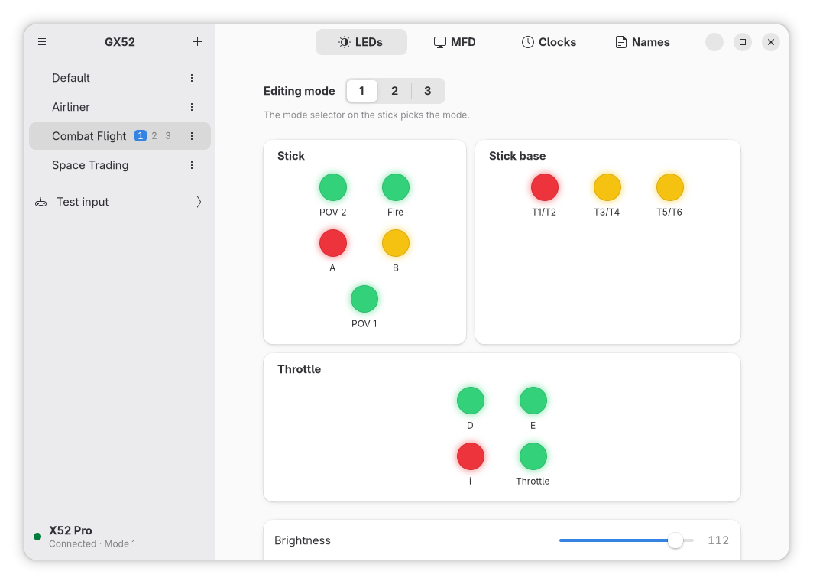
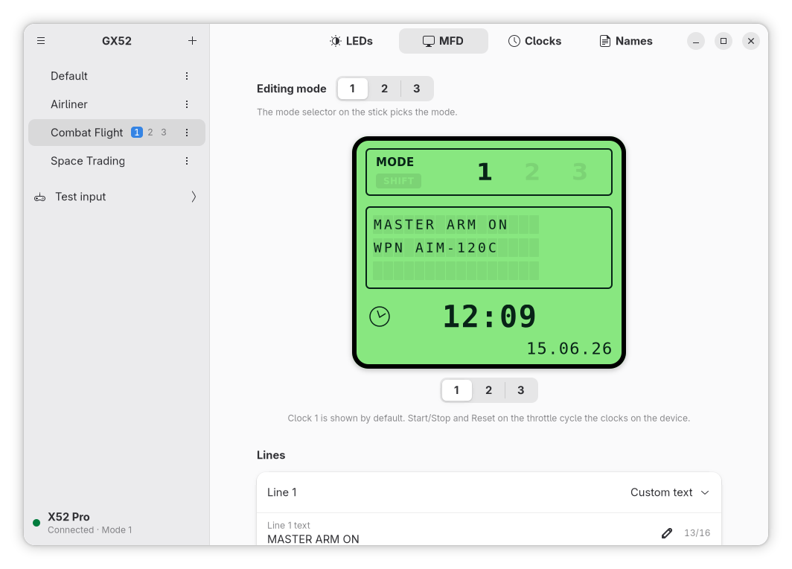
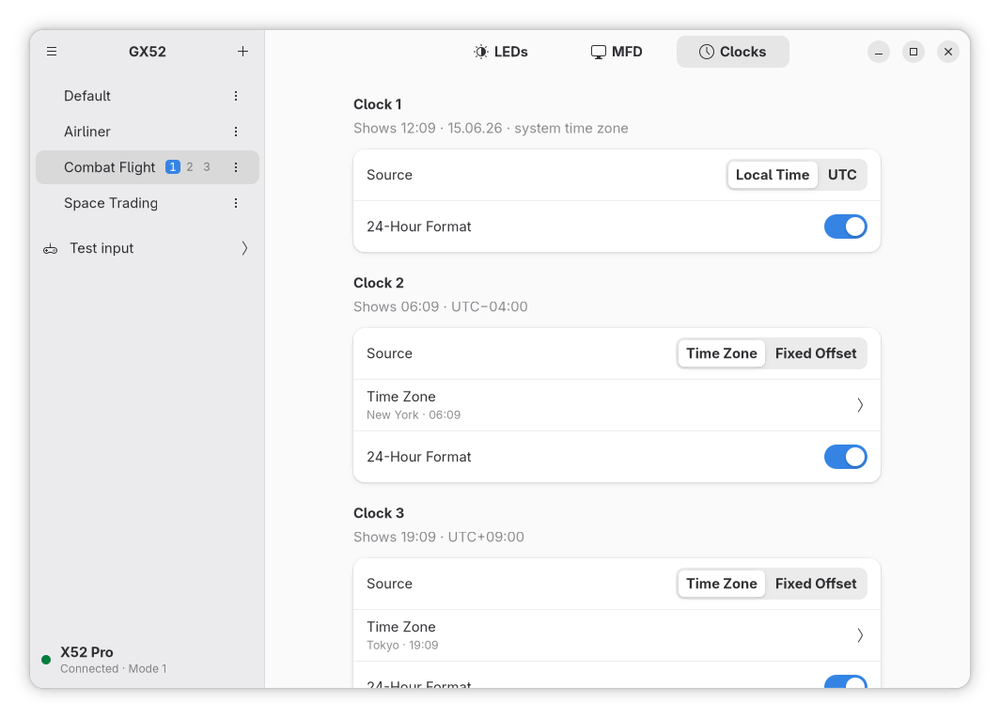
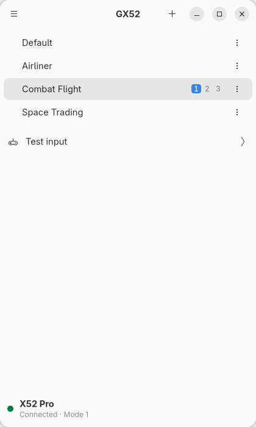
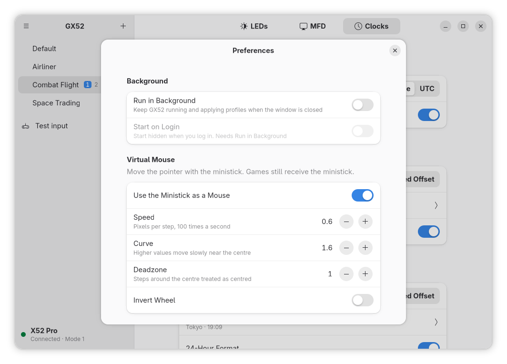
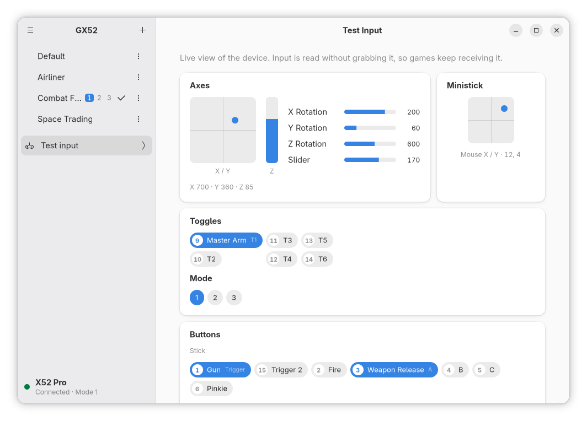
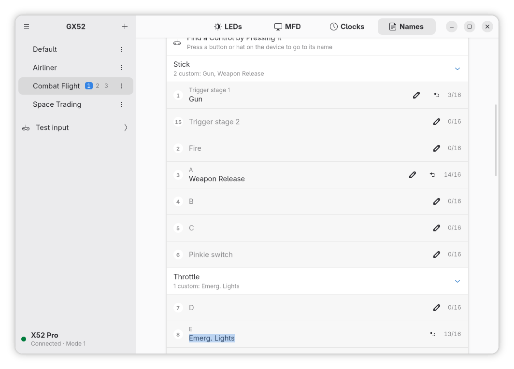

<div class="rdt-showcase" markdown>



</div>

<div class="rdt-install" markdown>

```bash
flatpak install flathub com.leinardi.gx52
flatpak run com.leinardi.gx52
```

</div>

## Features

<div class="grid cards" markdown>

- :lucide-lightbulb:{ .lg }

    **LEDs and display**

    LED colours and blinking on a schematic of the stick and throttle, the MFD text, and three
    clocks in real time zones.

- :lucide-layers:{ .lg }

    **Profiles**

    One set of settings, or one per position of the mode selector, with custom control names and
    TOML import and export.

- :lucide-gamepad-2:{ .lg }

    **Input tester and virtual mouse**

    A live view of every axis, button and hat, and a throttle ministick that moves the pointer.

- :lucide-monitor-smartphone:{ .lg }

    **Runs in the background**

    A tray icon, starting on login, with in-app guidance for the udev rule the joystick needs.

</div>

## Screenshots

<div class="grid" markdown>














</div>
